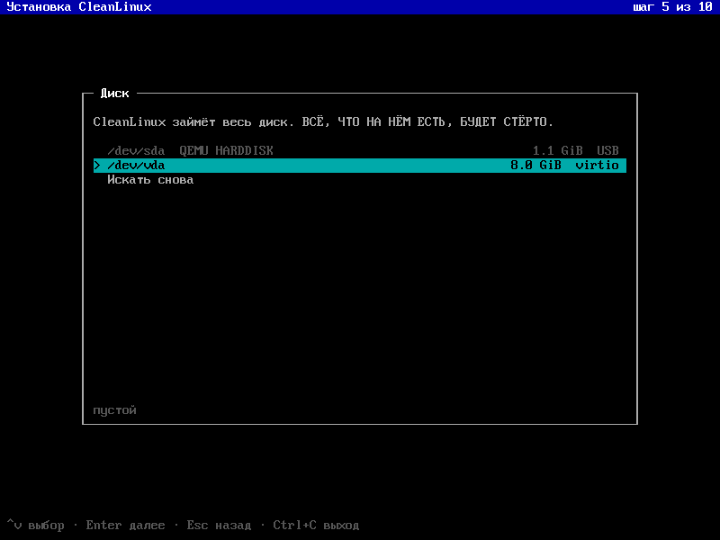
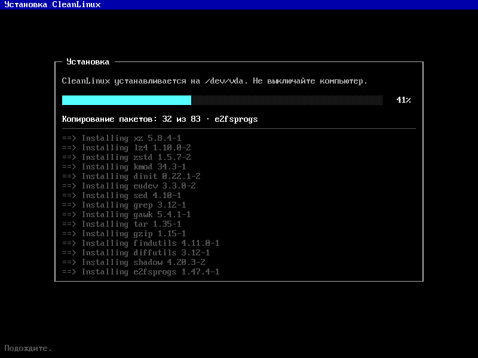
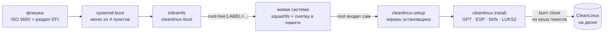
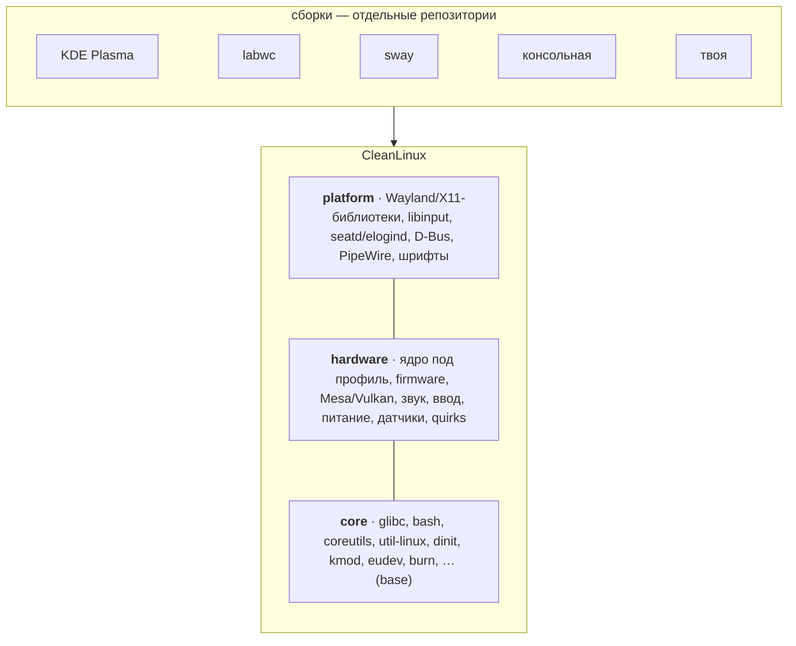
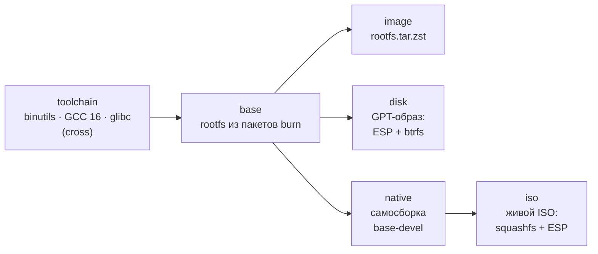

<div align="center">

# CleanLinux

**База для Linux-сборок, как Arch — собранная с нуля и под твоё железо**

[](https://github.com/vovawees/CleanLinux/releases/tag/iso-2026.11.5)


[](LICENSE)

[Установить](#установить-с-флешки) · [Идея](#идея) · [Железо](#поддерживаемое-железо) · [Собрать](#собрать-самому) · [Документация](#документация) · [English](#english)

</div>

CleanLinux — система, собранная **с нуля** (не LFS): свой пакетный менеджер **`burn`**, свои рецепты, свой
cross-first bootstrap. Драйверы и оптимизация под конкретное железо — ПК, ноутбуки, портативные консоли и
одноплатники на **x86_64 и arm64**. `burn` «прожигает» исходники в пакеты под твой процессор и видеокарту,
а обновляется всё по модели **rolling release+++** — с планом, снимком и откатом.

KDE Plasma, labwc, sway и любые другие DE и WM, приложения, Steam — **не часть базы**: это *сборки* поверх,
в своих репозиториях. База ничего не выбирает за тебя, но даёт всё, чтобы любая сборка хорошо работала на твоём железе.

> [!NOTE]
> **Статус: pre-alpha.** Живой ISO загружается с флешки или DVD (UEFI) и ставит систему на диск через
> установщик с экранами; это проверяется в QEMU (`tests/iso.py`), на настоящих ПК — пока нет
> ([отчёт о железе](https://github.com/vovawees/CleanLinux/issues/new?template=hardware_report.yml) очень поможет).
> Что дальше — [docs/ROADMAP.md](docs/ROADMAP.md) и доска [CleanLinux roadmap](https://github.com/users/vovawees/projects/1).

## Содержание

- [Установить с флешки](#установить-с-флешки)
- [Идея](#идея)
- [База и сборки](#база-и-сборки)
- [Rolling release+++](#rolling-release)
- [Поддерживаемое железо](#поддерживаемое-железо)
- [Репозитории проекта](#репозитории-проекта)
- [Структура](#структура)
- [Собрать самому](#собрать-самому)
- [Тесты](#тесты)
- [Документация](#документация)
- [Лицензия](#лицензия)
- [English](#english)

## Установить с флешки

| Шаг | Что сделать |
|---|---|
| **1. Скачать** | `cleanlinux-x86_64-generic-x86_64-20261105.iso` (1,2 ГБ) и `.sha256` из [релиза ISO](https://github.com/vovawees/CleanLinux/releases/tag/iso-2026.11.5) |
| **2. Записать** | образ целиком на флешку от 2 ГБ: `sudo dd if=cleanlinux-….iso of=/dev/sdX bs=4M conv=fsync status=progress`, [Rufus](https://rufus.ie) в режиме **DD-образа** или [balenaEtcher](https://etcher.balena.io) |
| **3. Загрузиться** | меню загрузки ПК (F12, F11, F8, Esc…) → «UEFI: флешка»; **Secure Boot выключен** |
| **4. Установить** | установщик открывается сам: язык → раскладка → часовой пояс → диск → шифрование → пользователь → пароли → «Стереть и установить» |

<p align="center">
  
  
</p>

Сеть для установки не нужна: всё, что ставится, уже в образе. Компьютер — любой x86_64 с UEFI примерно с 2010 года
(x86-64-v2), от 2 ГБ памяти и 8 ГБ диска. Установленная система — консольная база с компилятором и системами
сборки (`base-devel`) и редактором `nano`: `burn update` и графические сборки (`burn spin add`) ставятся сразу.
Подробно, с клавишами меню загрузки по производителям, всеми экранами установщика и решением проблем, —
в **[docs/INSTALL.md](docs/INSTALL.md)**.



| Экран установщика | Что там |
|---|---|
| Язык · Language | English или русский — на нём будут все экраны |
| Раскладка, часовой пояс | применяются сразу; в списках работает поиск по буквам |
| Диск | модель, размер, шина, что на нём сейчас; флешку установки выбрать нельзя |
| Шифрование | без него или LUKS2 — пароль при каждой загрузке |
| Компьютер и пользователь, root | имя компьютера, пользователь (группа `wheel`), пароли |
| Оборудование | если `burn profile detect` узнал устройство (Steam Deck, ROG Ally…) — его профиль |
| Установка → готово | шаги, счётчик пакетов, журнал; «Перезагрузить», «Выключить» или «Выйти в консоль» |

На диске: GPT, раздел EFI 512 МБ с systemd-boot и btrfs с подтомами `@`, `@home`, `@snapshots` (сжатие zstd),
по желанию — в LUKS2. Управление установщиком: стрелки, Enter, Esc — назад, Ctrl+C — выйти без изменений.

## Идея

| | |
|---|---|
| **База, а не витрина** | Только система, драйверы и оптимизация под железо. DE, WM, приложения и игры — сборки поверх; правило, что куда относится, — в [docs/SCOPE.md](docs/SCOPE.md). |
| **С нуля, но не LFS** | Свой пакетный менеджер, свой формат рецептов и свой cross-first bootstrap вместо книги с ручными шагами. |
| **Без бинарников** | Репозиторий [CleanLinux-Recipes](https://github.com/vovawees/CleanLinux-Recipes) — как AUR: только ссылки на исходники upstream, sha256 и рецепты. |
| **Под твоё железо** | Профиль устройства задаёт `-march`/`-mcpu`, драйверы GPU, параметры ядра и аппаратные features (аналог USE-флагов). |
| **Минимум ресурсов** | dinit вместо systemd, без документации, лишних локалей и статических библиотек, LTO. |
| **Совместимость** | glibc (не musl), merged `/usr` — проприетарные драйверы, Flatpak/AppImage и обычные бинарные программы работают. |
| **Свежее всё** | GCC 16, glibc 2.44, binutils 2.47, Linux 7.3, coreutils 9.12, bash 5.3, … — `tools/updates.sh` каждый день сверяет рецепты с upstream и публикует проверенные обновления в канал `edge`. |
| **Быстрая сборка** | Все исходники скачиваются параллельно и проверяются до начала сборки; `CCACHE=1`, `LINKER=mold`, LTO, `-O3` для горячего кода (zstd, lz4, zlib-ng). |
| **Воспроизводимость** | Тот же рецепт + флаги + тулчейн → побайтно тот же пакет (`SOURCE_DATE_EPOCH`, `-ffile-prefix-map`, фиксированные времена файлов). |
| **Железо** | Ядро под класс устройства: zswap/zram на zstd, MGLRU, BFQ для флеша, amd-pstate EPP, `PREEMPT_DYNAMIC`, BBR + fq; платформенные драйверы и встроенные контроллеры ROG Ally, Legion Go, MSI Claw, AYANEO, OneXPlayer, Steam Deck. |
| **x86_64 + arm64** | Обе архитектуры равноправны; любую можно собрать с любой (cross-first). |

## База и сборки



CleanLinux отвечает за три нижних слоя. Сборка — это репозиторий со своими рецептами, набором пакетов,
features и настройками; она ставится и обновляется тем же `burn` (`burn spin add`) и не меняет базу —
[docs/SPINS.md](docs/SPINS.md).

## Rolling release+++

Обычный rolling — «обновил всё и надейся». В CleanLinux у обновления есть страховка:

1. **План** — `burn plan` показывает, что обновится, риск (`core` / `major`) и какие пакеты придётся пересобрать.
2. **Сначала сборка, потом установка** — всё собирается в кеш; если хоть что-то не собралось, система не тронута.
3. **Снимок** — read-only снимок btrfs перед применением (burn делает его сам, без btrfs-progs) и pre-update хуки.
4. **ABI-aware** — сменилась soname библиотеки → старая сохраняется (*preserved libs*), зависимые пакеты пересобираются автоматически.
5. **Проверка** — `burn doctor` ищет пропавшие и устаревшие библиотеки.
6. **Откат и заморозка** — `burn rollback <pkg>`, `burn hold <pkg>`, журнал `burn history`.
7. **Каналы** — `main` (прошёл проверки `tools/check.sh`), `edge` (новые версии upstream каждый день, ссылки и sha256 проверены автоматически), `security` (`burn update --security`: только исправления уязвимостей).

Подробнее: [docs/ROLLING.md](docs/ROLLING.md).

## Поддерживаемое железо

| Профиль | Устройство | CPU | `VIDEO_CARDS` |
|---|---|---|---|
| `native` | эта машина (автоопределение) | `-march=native` / `-mcpu=native` | по `/sys` |
| `generic-x86_64` | любой x86_64 ПК с ~2009 г. — **профиль ISO** | `x86-64-v2` | amd intel nouveau virgl |
| `generic-x86_64-v3` | современные ПК (Haswell+, Zen+) | `x86-64-v3` (AVX2, FMA) | amd intel nouveau virgl |
| `generic-aarch64` | любая arm64-плата или устройство | `armv8-a` | freedreno panfrost v3d lima etnaviv virgl |
| `steam-deck` | Valve Steam Deck LCD/OLED | `znver2` | amd |
| `rog-ally` | ASUS ROG Ally / Ally X | `znver4` | amd |
| `rog-xbox-ally-x` | ASUS ROG Xbox Ally X, Lenovo Legion Go 2 (Z2 Extreme) | `znver5` | amd |
| `legion-go` | Lenovo Legion Go (Z1 Extreme) | `znver4` | amd |
| `legion-go-s` | Lenovo Legion Go S (Z2 Go) | `znver3` | amd |
| `msi-claw` | MSI Claw A1M (Meteor Lake) | `meteorlake` | intel |
| `msi-claw-ai-plus` | MSI Claw 7/8 AI+ (Lunar Lake) | `lunarlake` | intel |
| `mangmi-air-x` | Mangmi Air X (Snapdragon 662) | `cortex-a73.cortex-a53` + обход errata A53 | freedreno |
| `retroid-pocket-5` | Retroid Pocket 5 / Mini (Snapdragon 865) | `cortex-a77` | freedreno |
| `ayn-odin2` | AYN Odin 2 / Mini / Portal (Snapdragon 8 Gen 2) | `armv8.6-a+fp16fml`, tune `cortex-a715` | freedreno |
| `raspberry-pi-5` | Raspberry Pi 5 | `cortex-a76` | v3d |
| `rk3566-handheld` | Anbernic RG353/RG503, PowKiddy (RK3566) | `cortex-a55` | panfrost |
| `asus-x540ya` | ASUS X540YA (AMD E2-6110, Radeon R2) | `btver2` | amd (GCN 1.1 через amdgpu) |

```sh
burn profile list      # все профили
burn profile detect    # какой профиль подходит этой машине (установщик спрашивает его сам)
burn profile show      # итоговые CFLAGS, features, драйверы
```

Firmware в ISO — для видеокарт (AMD, Intel, NVIDIA GSP для nouveau), микрокод AMD и Wi-Fi, Bluetooth и Ethernet
ноутбуков и ПК (Intel, Realtek, MediaTek, Qualcomm Atheros, Broadcom, Marvell): около 2200 файлов (≈360 МБ), а не весь
linux-firmware. Что проверено на настоящих устройствах — [docs/HARDWARE.md](docs/HARDWARE.md).

## Репозитории проекта

| Репозиторий | Что это |
|---|---|
| **CleanLinux** (этот) | профили железа, bootstrap, образ диска и живой ISO, тесты в QEMU, документация |
| [CleanLinux-Recipes](https://github.com/vovawees/CleanLinux-Recipes) | рецепты базы — только текст: ссылки на upstream, sha256, команды сборки |
| [burn](https://github.com/vovawees/burn) | пакетный менеджер на C: рецепты, сборка, установка, rolling+++, `burn clone`, `burn spin` |
| [cleanlinux-boot](https://github.com/vovawees/cleanlinux-boot) | сервисы dinit для загрузки и помощник на C: ранние ФС, udev, getty, ядра в ESP, initramfs (LUKS, живая система) |
| [cleanlinux-install](https://github.com/vovawees/cleanlinux-install) | установщик на C: `cleanlinux-install` (командная строка) и `cleanlinux-setup` (экраны) |
| [cleanlinux-spin-template](https://github.com/vovawees/cleanlinux-spin-template), [cleanlinux-spin-labwc](https://github.com/vovawees/cleanlinux-spin-labwc) | шаблон сборки и первая сборка (labwc) |

## Структура

```
CleanLinux/
├── .ai/                    плотные заметки для ИИ-агентов: репозитории, сборка, ISO, установщик, подводные камни
├── .github/                шаблоны issues (баг, идея, отчёт о железе), pull request'а, CODEOWNERS — без Actions
├── bootstrap/
│   ├── bootstrap.sh        сборка с нуля: toolchain → base → tarball | disk | iso | native
│   ├── lib.sh              шаги стадий: тулчейн, base, образ диска, живой ISO
│   └── host-burn.sh        burn для хоста — из того же релиза, что ставится в систему
├── profiles/
│   ├── base.profile        общие умолчания: флаги, features, ядро
│   ├── generic-*.profile   x86_64 (v2, v3) и aarch64 для любых устройств
│   ├── native.profile      «эта машина»: -march=native, видеокарта по /sys
│   └── devices/            Steam Deck, ROG Ally, Legion Go, MSI Claw, Retroid, AYN, Raspberry Pi 5, …
├── tests/
│   ├── smoke.sh            сборка и установка настоящих рецептов в тестовый корень
│   ├── rolling.sh          rolling+++: soname bump, preserved libs, ABI-пересборка, hold, rollback
│   ├── kernel-config.sh    параметры ядра профилей разрешаются как задуманы
│   ├── boot.py             образ диска загружается в QEMU (UEFI) до входа
│   ├── install.py          образ ставится на диск cleanlinux-install (и в LUKS2)
│   ├── iso.py              ISO с флешки в QEMU: экраны установщика → установленная система
│   └── native-repro.sh     нативная пересборка даёт те же пакеты
├── tools/
│   ├── check.sh            все проверки (--quick перед push, --full с ISO в QEMU)
│   ├── screenshots.py      снимки экранов установщика с ISO в QEMU — для документации
│   └── …                   hooks/pre-push, profiles-tarball.sh, dt-kconfig.py
└── docs/                   INSTALL, SCOPE, ARCHITECTURE, ROLLING, RECIPES, SPINS, HARDWARE, ROADMAP
    └── images/             снимки экранов установщика
```

## Собрать самому

Попробовать `burn` без root — пакеты ставятся в отдельный корень:

```sh
git clone https://github.com/vovawees/CleanLinux
git clone https://github.com/vovawees/CleanLinux-Recipes
git clone https://github.com/vovawees/burn && make -C burn    # компилятор C и libzstd
cd CleanLinux
alias burn="$PWD/../burn/burn -R $PWD/../CleanLinux-Recipes/packages"
export BURN_PROFILE_DIR=$PWD/profiles

burn search
burn info zstd
burn profile detect
tests/smoke.sh      # собирает и ставит zstd, zlib-ng, xz, lz4, pkgconf в тестовый корень
tests/rolling.sh    # soname bump, preserved libs, ABI-пересборка, hold, rollback
```

Собрать систему с нуля и живой ISO — без root-прав, на любом Linux x86_64 или arm64:

```sh
bootstrap/bootstrap.sh --arch x86_64 toolchain base iso   # живой ISO: тулчейн → base → native → ISO
bootstrap/bootstrap.sh --arch x86_64 iso                  # пересобрать только ISO, когда base уже есть
bootstrap/bootstrap.sh --arch x86_64 disk                 # образ диска для QEMU или dd на диск
bootstrap/bootstrap.sh --arch x86_64 all                  # всё: toolchain base native image disk iso
bootstrap/bootstrap.sh --profile mangmi-air-x all         # arm64 под устройство
```



| Стадия | Что получается | Время на 2 ядрах (замер) |
|---|---|---|
| `toolchain` | кросс-тулчейн и glibc в rootfs | ~65 мин |
| `base` | базовая система из пакетов burn | ~85 мин |
| `native` | `base-devel`, собранный самой системой (perl, python, cmake, meson…) | ~70 мин |
| `iso` | `build/<arch>/cleanlinux-<arch>-<профиль>-ДАТА.iso` + `.sha256` | ~1 ч: ядро ~50 мин, сам образ — меньше минуты |
| `disk` | `build/<arch>/cleanlinux-<arch>-<профиль>-ДАТА.img` | минуты, если ядро уже собрано для `iso` |

Собранное кешируется (`build/cache/packages`): повторная сборка ISO после правки одного пакета занимает минуту-две.

Хосту нужны gcc/g++, make, bison, flex, gawk, m4, bc, gperf, perl (со всеми модулями ядра Perl: на Fedora,
RHEL, Amazon Linux — `perl-core`), python3, ninja, cmake, pkg-config, git, curl и заголовки libzstd, libelf и
OpenSSL; для образов — mtools, dosfstools и модули python3 jinja2 и pyelftools (сборка systemd-boot), для ISO —
ещё xorriso и squashfs-tools с zstd; для чужой архитектуры — `qemu-user`. burn для хоста bootstrap собирает сам,
meson берёт из рецепта. Каждый шаг пишет лог в `build/<arch>/logs/` и отметку в `build/<arch>/stamps/` —
прерванный bootstrap продолжается с того же места. Места нужно около 25 ГБ. Переменные ISO (`ISO_FIRMWARE`,
`ISO_PACKAGES`, `ISO_LABEL`, `--spin`) — в [docs/INSTALL.md](docs/INSTALL.md#собрать-образ-самому).

## Тесты

Хостингового CI нет: всё проверяется локально, `tools/check.sh` — перед каждым push (hook `tools/hooks/pre-push`).

| Тест | Что проверяет | Нужно |
|---|---|---|
| `tools/check.sh` | ShellCheck, профили, рецепты, ссылки в документации | — |
| `tests/smoke.sh` | сборка и установка настоящих рецептов | burn |
| `tests/rolling.sh` | весь цикл rolling+++ | burn |
| `tests/kernel-config.sh` | профили дают ядру нужные параметры | исходники ядра |
| `tests/boot.py IMG` | образ диска грузится в QEMU (UEFI) до входа, без ошибок сервисов | QEMU, OVMF |
| `tests/install.py IMG [--encrypt]` | установка с образа на другой диск и загрузка с него | QEMU, OVMF |
| `tests/iso.py ISO [--encrypt] [--cdrom]` | ISO как флешка (USB) или DVD: экраны установщика по-русски, живая система, установленная система | QEMU, OVMF |
| `tests/native-repro.sh` | нативная пересборка совпадает с cross-сборкой | система после `bootstrap native` |

## Документация

| Документ | О чём |
|---|---|
| [docs/INSTALL.md](docs/INSTALL.md) | установка с флешки: запись, загрузка, экраны установщика, первый запуск, проблемы |
| [docs/SCOPE.md](docs/SCOPE.md) | что входит в базу, а что ставится сверху |
| [docs/ARCHITECTURE.md](docs/ARCHITECTURE.md) | из чего состоит система и почему так |
| [docs/ROLLING.md](docs/ROLLING.md) | как устроены обновления rolling release+++ |
| [docs/RECIPES.md](docs/RECIPES.md) | как писать рецепты |
| [docs/SPINS.md](docs/SPINS.md) | как сделать сборку поверх базы и что база ей гарантирует |
| [docs/HARDWARE.md](docs/HARDWARE.md) | профили устройств и что на них проверено |
| [docs/ROADMAP.md](docs/ROADMAP.md) | что дальше (и [доска roadmap](https://github.com/users/vovawees/projects/1)) |
| [CONTRIBUTING.md](CONTRIBUTING.md) | как участвовать: проверки, коммиты, pull request'ы |
| [.ai/](.ai/README.txt) | заметки для ИИ-агентов, которые продолжают работу |

## Лицензия

MIT — см. [LICENSE](LICENSE). Пакеты распространяются под своими лицензиями (указаны в рецептах).

## English

**CleanLinux** is a **base for Linux spins, like Arch**: a system built **from scratch** (not LFS), drivers and
hardware-specific tuning for PCs, laptops, handhelds and boards, on **x86_64 and arm64**. Desktops, window
managers, applications and games are not part of the base: they are *spins* on top (KDE Plasma, labwc, sway, ...),
maintained in their own repositories and installed with the same package manager (see [docs/SCOPE.md](docs/SCOPE.md)).

- **Install from a USB stick**: download the live ISO from the [releases](https://github.com/vovawees/CleanLinux/releases), write the whole image to a stick (`dd`, Rufus in DD mode, balenaEtcher), boot it on a UEFI PC with Secure Boot off, and the installer with screens (`cleanlinux-setup`, English or Russian) installs CleanLinux to a disk: GPT, a 512 MB ESP with systemd-boot, btrfs with `@`, `@home`, `@snapshots`, optionally in LUKS2. No network is needed: the ISO carries the packages it installs (`burn clone`). See [docs/INSTALL.md](docs/INSTALL.md#english).
- There are no binary repositories: [CleanLinux-Recipes](https://github.com/vovawees/CleanLinux-Recipes) holds only upstream source links, checksums and build recipes (like the AUR, but for the whole system), and the `burn` package manager builds everything locally, tuned by a hardware profile (CPU flags, GPU drivers, kernel options, hardware features).
- glibc (not musl), GCC 16, merged `/usr`, dinit; minimal by default (no docs, extra locales or static libraries; LTO).
- **Rolling release+++**: updates are planned, fully built before anything is installed, snapshotted, ABI-aware (preserved libraries + automatic rebuilds after soname changes), verified with `burn doctor`, and can be rolled back or held per package. A daily upstream watcher publishes verified version bumps to the `edge` channel.
- Hardware: kernel defaults per device class (zstd zswap/zram, MGLRU, BFQ for flash, amd-pstate EPP, `PREEMPT_DYNAMIC`, BBR + fq), platform and built-in controller drivers for ROG Ally / Legion Go / MSI Claw / AYANEO / OneXPlayer / Steam Deck, profiles for 13 devices.
- Cross-first bootstrap without root: `bootstrap/bootstrap.sh --arch x86_64 all` builds a cross toolchain, glibc, the base system and the live ISO from any Linux host; `disk` makes a GPT image instead.
- Status: pre-alpha. The ISO boots and installs in QEMU (`tests/iso.py`, as a USB stick or a DVD), the disk image too (`tests/boot.py`, `tests/install.py [--encrypt]`); real hardware is not verified yet ([docs/HARDWARE.md](docs/HARDWARE.md)). Next steps: [docs/ROADMAP.md](docs/ROADMAP.md) and the [roadmap board](https://github.com/users/vovawees/projects/1). No hosted CI: `tools/check.sh` runs locally ([CONTRIBUTING.md](CONTRIBUTING.md)).
