# Установка CleanLinux с флешки

Живой образ CleanLinux — один файл `cleanlinux-x86_64-generic-x86_64-ДАТА.iso`. Его записывают на флешку
**как есть** (или на DVD), загружают с него ПК — и открывается установщик с экранами `cleanlinux-setup`:
язык, раскладка, часовой пояс, диск, шифрование, пользователь, пароли — и через несколько минут
CleanLinux стоит на диске. Сеть для установки не нужна: всё, что ставится, уже лежит в образе.

*English summary [below](#english).*

## Содержание

- [Что нужно](#что-нужно)
- [1. Скачать и проверить образ](#1-скачать-и-проверить-образ)
- [2. Записать на флешку](#2-записать-на-флешку)
- [3. Загрузиться с флешки](#3-загрузиться-с-флешки)
- [4. Установщик](#4-установщик)
- [5. Первый запуск](#5-первый-запуск)
- [Установка из командной строки](#установка-из-командной-строки)
- [Если что-то пошло не так](#если-что-то-пошло-не-так)
- [Как устроен образ](#как-устроен-образ)
- [Собрать образ самому](#собрать-образ-самому)

## Что нужно

| | |
|---|---|
| **Компьютер** | 64-битный ПК или ноутбук x86_64 с **UEFI** (почти все с 2012 года); процессор x86-64-v2 — Intel Core i3/i5/i7 и новее, AMD FX, Ryzen и APU с 2011 года |
| **Secure Boot** | **выключен** в настройках UEFI: загрузчик и ядро не подписаны |
| **Память** | от 2 ГБ (живая система пишет в память); для пункта «copy to RAM» — ещё размер образа |
| **Диск** | от 8 ГБ (меньше 3,5 ГБ установщик не возьмёт); **диск стирается целиком** |
| **Флешка** | от 2 ГБ; всё на ней будет стёрто |

Старые ПК без UEFI (только BIOS/Legacy/CSM) не поддерживаются: установленная система — это GPT, раздел EFI
и systemd-boot.

## 1. Скачать и проверить образ

Образ и его контрольная сумма — в [релизах CleanLinux](https://github.com/vovawees/CleanLinux/releases)
(файлы `cleanlinux-…iso` и `cleanlinux-…iso.sha256`).

| Система | Проверка |
|---|---|
| Linux, macOS | `sha256sum -c cleanlinux-…iso.sha256` (macOS: `shasum -a 256 -c …`) |
| Windows (PowerShell) | `Get-FileHash .\cleanlinux-…iso -Algorithm SHA256` — сравнить с числом из `.sha256` |

## 2. Записать на флешку

Образ пишется на флешку **целиком, побайтно** — не копированием файлов. Тогда на флешке получаются и
раздел EFI с загрузчиком, и файловая система ISO 9660 с меткой `CLEANLINUX_ДАТА`, которую ищет initramfs.

| Где | Чем | Как |
|---|---|---|
| Linux | `dd` | `lsblk` — найти флешку (например, `/dev/sdb`, **не раздел** `sdb1`), затем `sudo dd if=cleanlinux-…iso of=/dev/sdb bs=4M conv=fsync oflag=direct status=progress` |
| Linux | GNOME Disks, KDE ISO Image Writer | «Восстановить образ диска» / выбрать ISO и флешку |
| Windows | [Rufus](https://rufus.ie) | выбрать флешку и ISO → «Старт» → на вопрос о гибридном образе выбрать **«Записать в режиме DD-образа»** (режим ISO не подойдёт) |
| Windows, macOS, Linux | [balenaEtcher](https://etcher.balena.io) | Flash from file → флешка → Flash |
| macOS | `dd` | `diskutil list` → `diskutil unmountDisk /dev/diskN` → `sudo dd if=cleanlinux-…iso of=/dev/rdiskN bs=4m` |
| Виртуальная машина | — | подключить ISO как CD/DVD (VirtualBox, VMware, virt-manager: включить EFI) |

Ventoy и копирование файлов на флешку не проверены и, скорее всего, не загрузятся: initramfs ищет устройство
с меткой образа.

## 3. Загрузиться с флешки

1. Вставьте флешку и включите ПК, сразу нажимая клавишу меню загрузки:

   | Производитель | Меню загрузки | Настройки UEFI (Secure Boot) |
   |---|---|---|
   | ASUS | F8 или Esc | F2 или Del |
   | Acer | F12 | F2 |
   | Dell | F12 | F2 |
   | HP | F9 (или Esc → F9) | F10 |
   | Lenovo | F12 (или кнопка Novo) | F1 или F2 |
   | MSI | F11 | Del |
   | Gigabyte | F12 | Del |
   | ASRock | F11 | F2 или Del |
   | Samsung, Toshiba | F12 / Esc | F2 |

2. Выберите флешку с пометкой **UEFI** (например, «UEFI: SanDisk»). Если ПК пишет о Secure Boot —
   выключите его в настройках UEFI (раздел Security или Boot → Secure Boot → Disabled).
3. Появится меню загрузчика (systemd-boot), через 5 секунд загрузится первый пункт:

   | Пункт | Когда выбирать |
   |---|---|
   | **CleanLinux live** | обычно |
   | CleanLinux live (copy to RAM) | система копируется в память, флешку можно вынуть (нужно памяти на размер образа + 1 ГБ) |
   | CleanLinux live (safe graphics) | чёрный экран или мусор после загрузки: без драйверов видеокарты (`nomodeset`) |
   | CleanLinux live (serial console) | установка по последовательному порту (`console=ttyS0,115200`) |

   Клавиша `e` в меню правит параметры ядра выбранного пункта.

   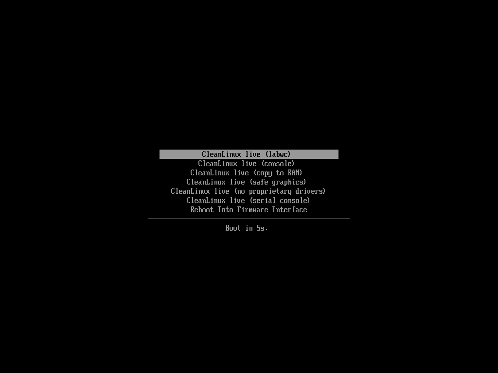

## 4. Установщик

Через несколько секунд после загрузки root входит сам, и на экране — установщик `cleanlinux-setup`.
Управление: стрелки, **Enter** — дальше, **Esc** — назад, **Tab** — между полями, буквы — поиск в списках,
**Ctrl+C** — выйти (ничего не изменено). Внизу экрана всегда видны подсказки по клавишам.

| Шаг | Экран | Что там |
|---|---|---|
| 1 | Язык · Language | English или русский — на нём будут все экраны |
| 2 | Добро пожаловать | что произойдёт; для русского сразу включается шрифт с кириллицей |
| 3 | Раскладка клавиатуры | раскладка консоли (включается сразу); для русской — переключение Alt+Shift |
| 4 | Часовой пояс | часть света → город; можно печатать: `eur`, затем `mosc` |
| 5 | Диск | модель, размер, шина и что на диске сейчас; флешку установки и занятые диски выбрать нельзя |
| 6 | Шифрование | без шифрования или LUKS2 (пароль спрашивается при каждой загрузке) |
| 7 | Компьютер и пользователь | имя компьютера, имя пользователя (он в группе `wheel`), его пароль дважды |
| 8 | Администратор (root) | тот же пароль, что у пользователя, или отдельный |
| 9 | Оборудование | только если `burn profile detect` узнал устройство (Steam Deck, ROG Ally…): взять его профиль |
| 10 | Всё готово к установке | сводка; дальше — подтверждение «Стереть диск?» (по умолчанию — «Назад») |
| — | Установка | шаги, счётчик пакетов, полоса прогресса и хвост журнала `/tmp/cleanlinux-install.log` |
| — | CleanLinux установлен | «Перезагрузить», «Выключить» или «Выйти в консоль» |

Так выглядят экраны (снимки — `tools/screenshots.py` с этого же ISO в QEMU, установка с шифрованием):

<table>
<tr>
<td width="50%">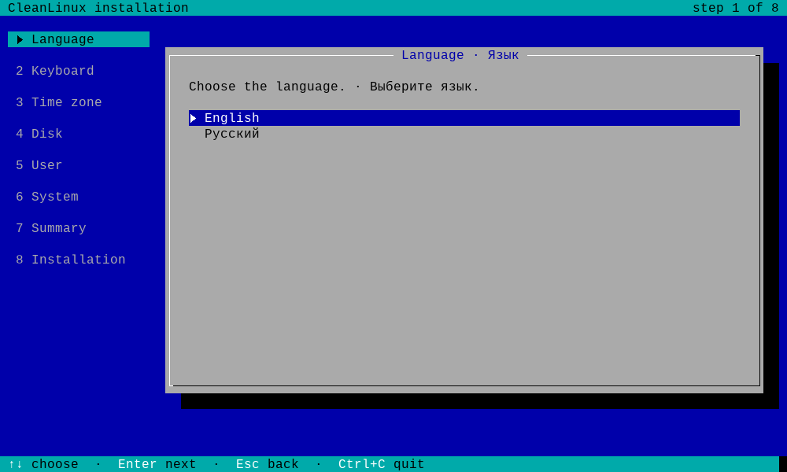<br><b>1</b> · язык</td>
<td width="50%">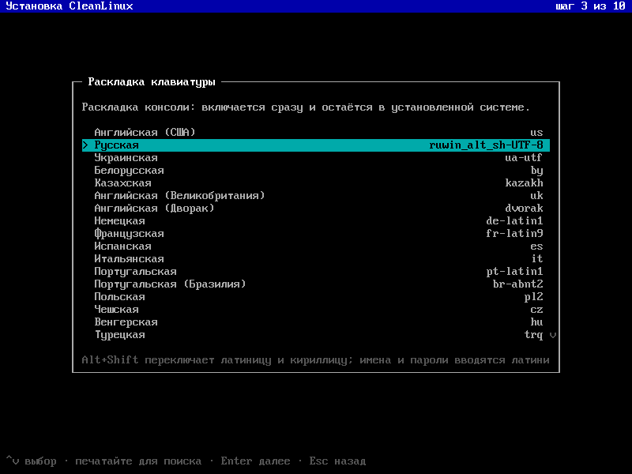<br><b>3</b> · раскладка клавиатуры</td>
</tr>
<tr>
<td>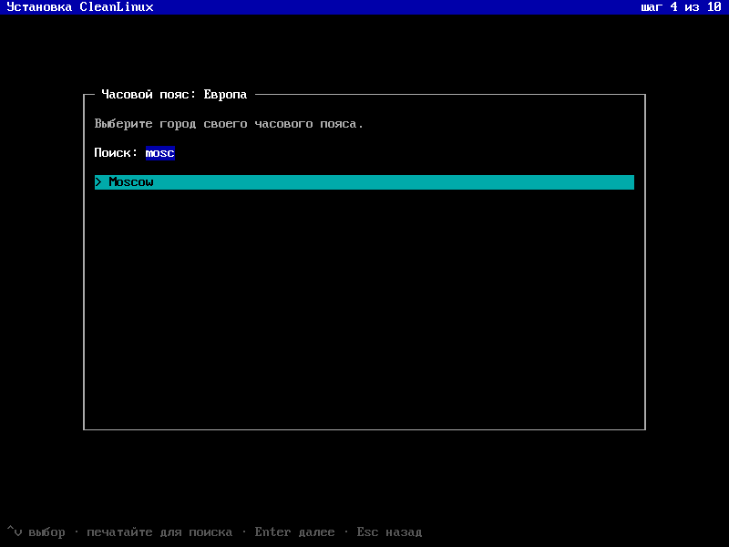<br><b>4</b> · часовой пояс: напечатано <code>mosc</code></td>
<td>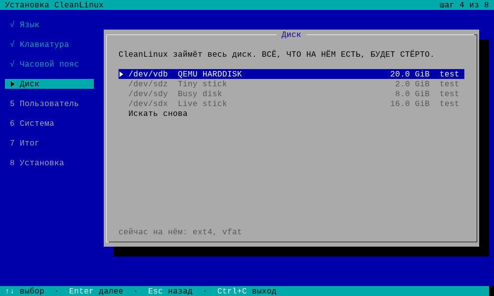<br><b>5</b> · диск: флешка установки серая</td>
</tr>
<tr>
<td>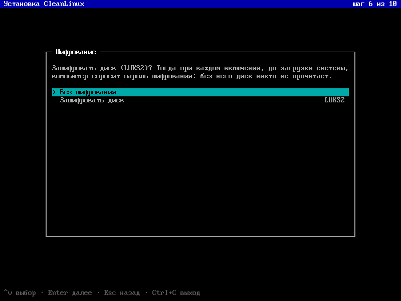<br><b>6</b> · шифрование</td>
<td>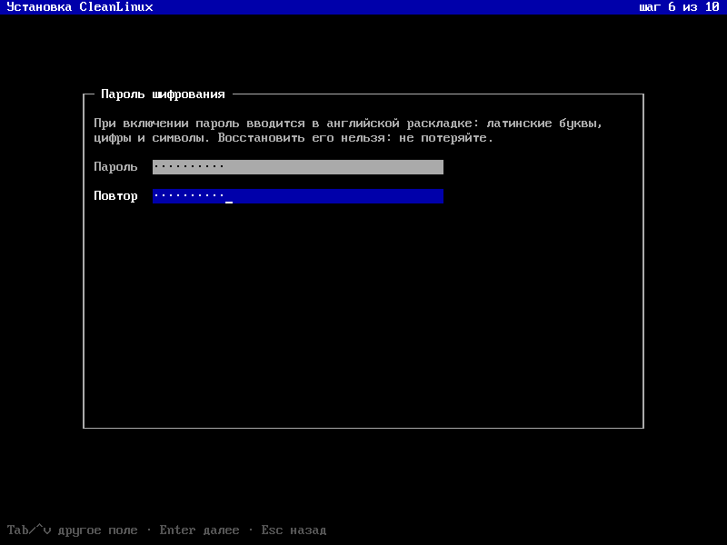<br><b>6</b> · пароль шифрования, дважды</td>
</tr>
<tr>
<td>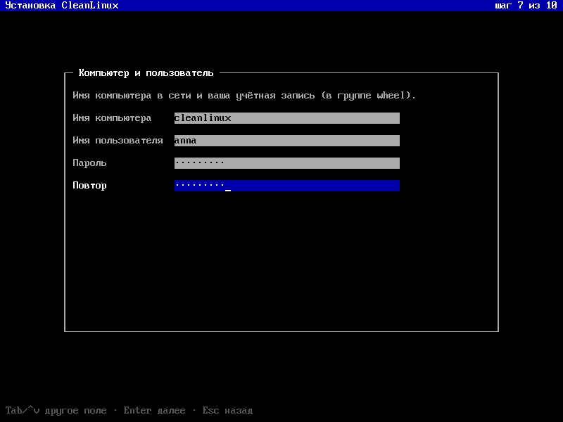<br><b>7</b> · компьютер и пользователь</td>
<td>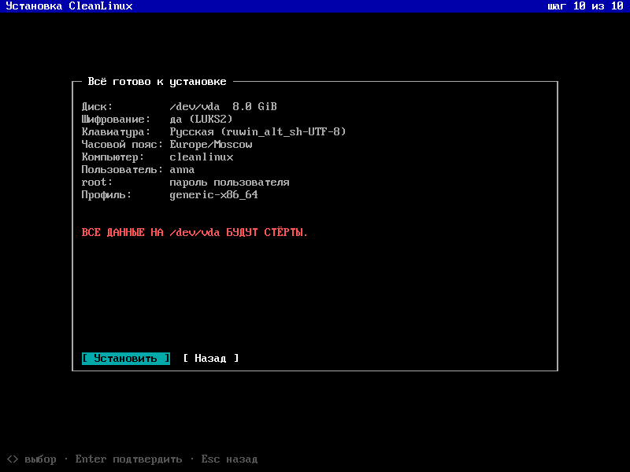<br><b>10</b> · сводка</td>
</tr>
<tr>
<td>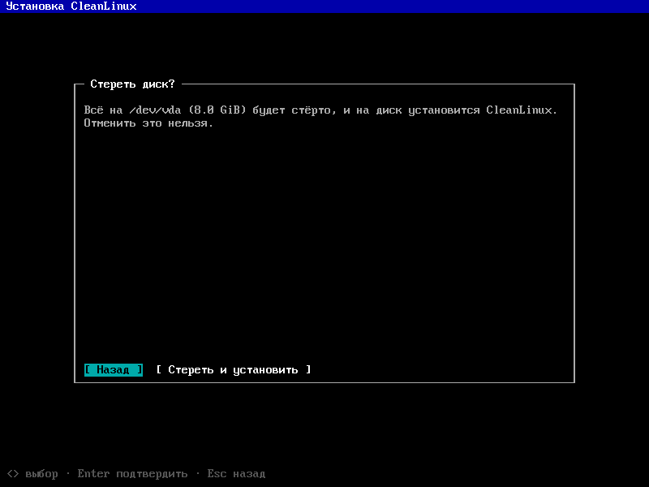<br>подтверждение, по умолчанию — «Назад»</td>
<td>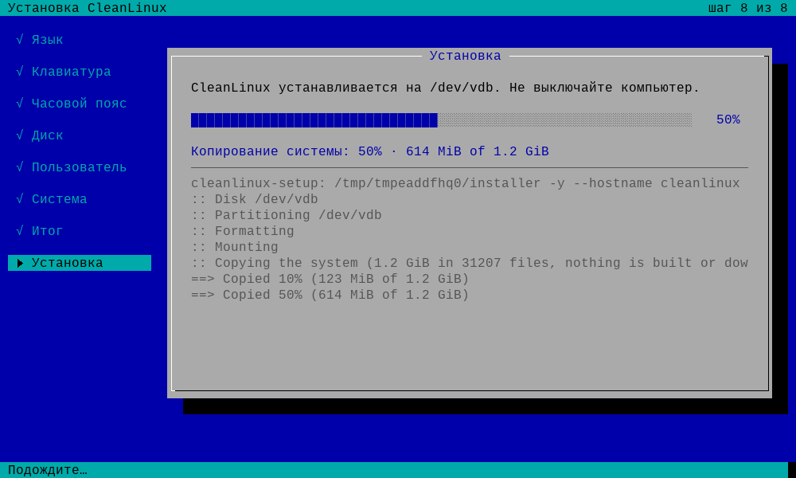<br>установка: пакеты копируются с флешки</td>
</tr>
<tr>
<td>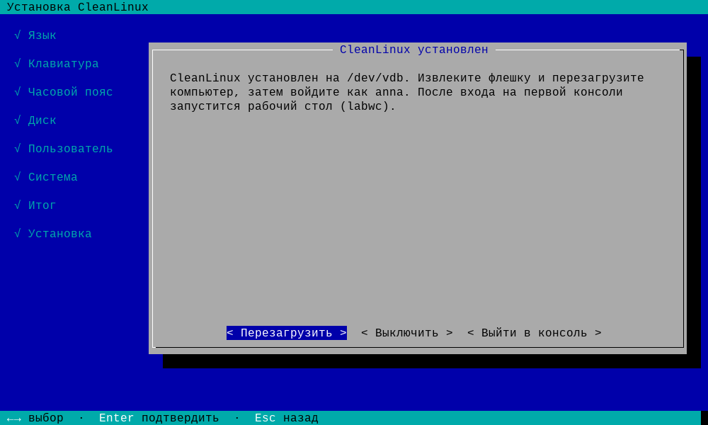<br>готово</td>
<td></td>
</tr>
</table>

Вынимать флешку — после выключения или когда экран погас при перезагрузке. Если установщик закрыт,
снова открыть его: `cleanlinux-setup`. На других консолях (Alt+F2…F4) тоже вошёл root — там обычная
командная строка с подсказками.

### Что установщик делает с диском

```
/dev/sdX (или nvme0n1), GPT
├── 1  EFI System, 512 МБ, vfat        → /boot   systemd-boot, ядро, записи загрузчика
└── 2  CleanLinux, остальное, btrfs    (в LUKS2 при шифровании), сжатие zstd
       ├── @            → /
       ├── @home        → /home
       └── @snapshots   → /.snapshots   снимки burn перед обновлениями
```

Новая система получает те же сборки пакетов, что у живой (`burn clone` из кеша пакетов образа), и выбранные
настройки: `/etc/hostname`, `/etc/localtime`, `/etc/vconsole.conf`, пользователя, пароли, `fstab`, запись
загрузчика и запись в меню загрузки UEFI («CleanLinux» — первой). От живой системы в ней нет ничего
живого: ни автовхода, ни установщика при входе.

## 5. Первый запуск

После перезагрузки (флешка вынута) войдите под своим пользователем; root — `su -` с паролем root.

```sh
iwctl station wlan0 scan                 # Wi-Fi (проводная сеть настраивается сама, dhcpcd)
iwctl station wlan0 get-networks
iwctl station wlan0 connect "Моя сеть"
burn sync && burn plan                   # свежие рецепты и что обновится
burn update                              # сборка, снимок, установка
burn spin add https://github.com/vovawees/cleanlinux-spin-labwc   # графическая сборка поверх базы
```

Сеть Wi-Fi, к которой вы подключились в живой системе (`iwctl`), установщик переносит в новую сама.
В системе есть редактор `nano` и всё для сборки (`base-devel`: GCC, make, perl, python, cmake, meson): burn
собирает обновления и сборки прямо на этом компьютере — графическая сборка в первый раз собирается долго
(часы, смотря по процессору), дальше обновляется только изменившееся.

## Установка из командной строки

Экраны — это обёртка над `cleanlinux-install`; в консоли живой системы им можно пользоваться напрямую:

```sh
cleanlinux-install --help
cleanlinux-install --user anna --timezone Europe/Moscow --keymap ruwin_alt_sh-UTF-8 \
    --font latarcyrheb-sun16 /dev/nvme0n1                  # весь диск (спросит пароли)
cleanlinux-install --encrypt --user anna /dev/sda         # корень в LUKS2
cleanlinux-install --target /mnt                          # свои разделы: корень и ESP (/mnt/boot) смонтированы заранее
```

Последний вариант — для установки рядом с другой системой: разметьте диск сами (раздел EFI можно взять
общий), смонтируйте корень в `/mnt` и ESP в `/mnt/boot`.

## Если что-то пошло не так

| Признак | Что делать |
|---|---|
| ПК не видит флешку в меню загрузки | записать заново в режиме DD; проверить, что в настройках включена загрузка с USB, а режим — UEFI |
| «Secure Boot violation», «Verification failed» | выключить Secure Boot |
| `the live medium LABEL=… did not appear` | образ скопирован файлами, а не записан целиком, или флешка не успела появиться — записать заново (dd, Rufus DD, Etcher), попробовать другой порт USB |
| чёрный экран после меню | пункт **safe graphics** |
| нет Wi-Fi | в образе прошивки самых частых чипов (Intel, Realtek, MediaTek, Qualcomm Atheros, Broadcom, Marvell); подключите кабель, а после установки закомментируйте строку `FIRMWARE=` в `/etc/burn/burn.conf` (или допишите в неё нужный префикс) и выполните `burn --rebuild install linux-firmware` — соберутся все (или нужные) прошивки |
| установка не удалась | экран показывает хвост журнала; весь журнал — `/tmp/cleanlinux-install.log` (Alt+F2, затем можно скопировать на другую флешку) |
| после установки грузится не CleanLinux | выбрать «CleanLinux» в меню загрузки UEFI или поставить его первым в настройках |

## Как устроен образ

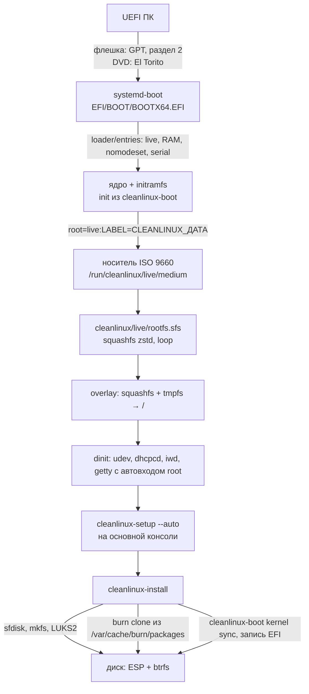

| Где | Что |
|---|---|
| раздел 2 (GPT) / образ El Torito | FAT: `EFI/BOOT/BOOTX64.EFI` (systemd-boot), `cleanlinux/<версия>/linux` и `initramfs.img`, `loader/` |
| ISO 9660, `CLEANLINUX_ДАТА` | `cleanlinux/live/rootfs.sfs` — вся система, `README.txt` |
| внутри `rootfs.sfs` | `base` и `base-devel` (GCC, make, perl, python, cmake, meson…), ядро, systemd-boot, установщик, iwd, nano, прошивки для ПК, `wireless-regdb`; кеш пакетов `/var/cache/burn/packages` |
| `/etc/burn/burn.conf` | `FIRMWARE="…"` — какие прошивки собраны; новая система его сохраняет (с профилем устройства — список профиля) |

## Собрать образ самому

```sh
bootstrap/bootstrap.sh --arch x86_64 toolchain base iso     # с нуля: ~4–5 часов на 2 ядрах
tests/iso.py build/x86_64/cleanlinux-x86_64-generic-x86_64-*.iso   # установка через экраны в QEMU
tests/iso.py --encrypt --cdrom build/x86_64/cleanlinux-…iso        # LUKS2, образ как CD
```

Для образа на хосте нужны `xorriso`, `squashfs-tools` (с zstd), `mtools`, `dosfstools` и то же, что для
`disk` (модули python3 jinja2 и pyelftools для systemd-boot); root не нужен, но стадии `native` нужны
непривилегированные user namespaces (`unshare -r`) и та же архитектура, что у образа (или qemu-user). Переменные:

| Переменная | По умолчанию | Что |
|---|---|---|
| `ISO_FIRMWARE` | GPU, Wi-Fi, Bluetooth, Ethernet для ПК | префиксы `/usr/lib/firmware` для `linux-firmware`; `all` — все прошивки (+2 ГБ) |
| `ISO_PACKAGES` | `linux-firmware wireless-regdb` | пакеты поверх `DISK_PACKAGES` (ядро, systemd-boot, установщик, iwd, nano) |
| `ISO_BASE_DEVEL` | `1` | `base-devel` в образе: установленная система сама собирает обновления и сборки (стадия `native` выполнится перед ISO, если `base-devel` ещё не собран); `0` — без стадии `native`: в образе то, что есть в rootfs |
| `ISO_COMPRESSION` | `-comp zstd -Xcompression-level 15 -b 1M` | параметры `mksquashfs` |
| `ISO_LABEL` | `CLEANLINUX_ДАТА` | метка тома, которую ищет initramfs |
| `--spin URL` | — | сборка поверх базы прямо в образе (как для `disk`) |

## English

The CleanLinux live ISO is written to a USB stick **as a whole** (dd, Rufus in *DD image* mode, balenaEtcher) or
burnt to a DVD, and boots on UEFI PCs with Secure Boot off. Root logs in by itself and the installer with screens
(`cleanlinux-setup`, English or Russian) opens: keyboard layout, time zone, disk (the whole disk is erased: GPT, a
512 MB ESP and btrfs with `@`, `@home`, `@snapshots`, optionally in LUKS2), user and passwords; the new system gets
the very package builds of the live system from its package cache (`burn clone`), so no network is needed. Boot
menu: live, *copy to RAM*, *safe graphics* (`nomodeset`), *serial console*. If the live medium is not found, the
image was copied as files: write it again in raw mode. Build it with `bootstrap/bootstrap.sh --arch x86_64 toolchain
base iso`; `tests/iso.py` installs from it through the screens in QEMU and boots the result.
