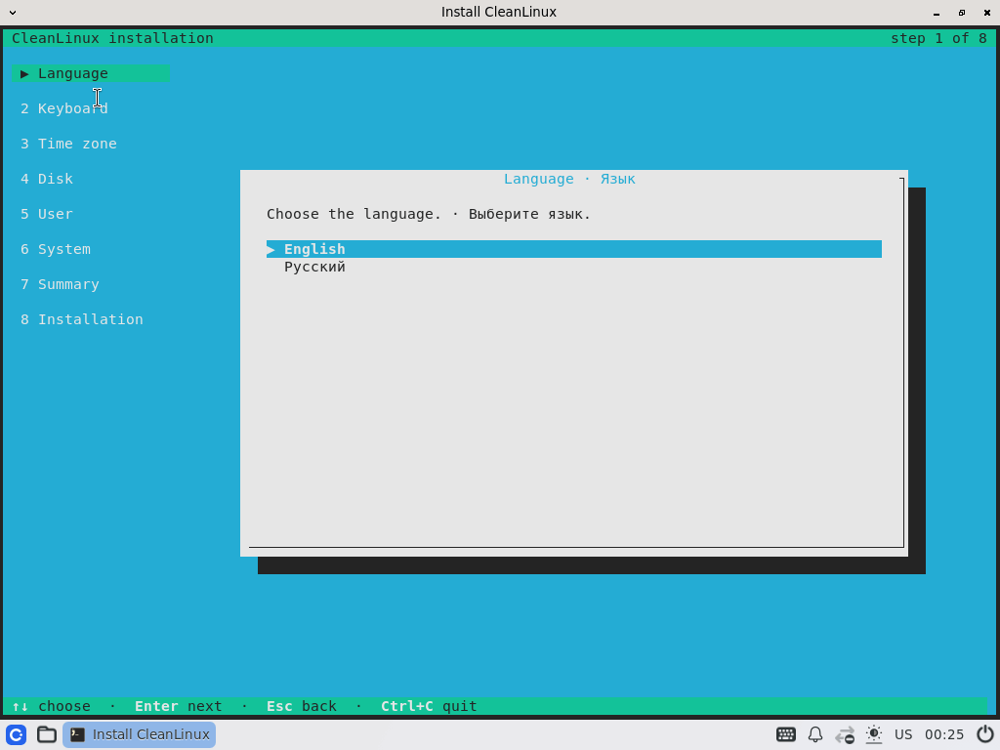
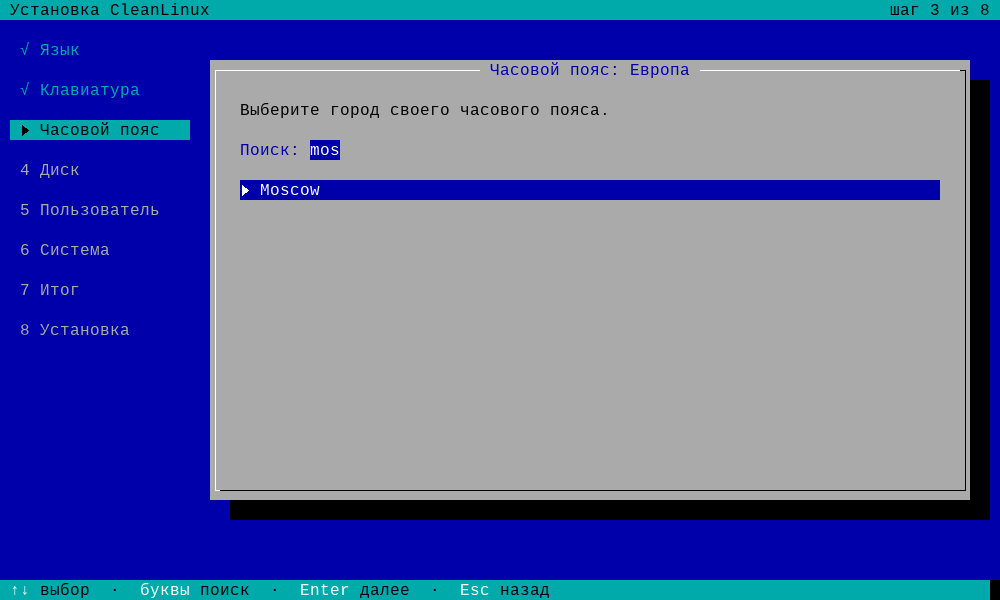
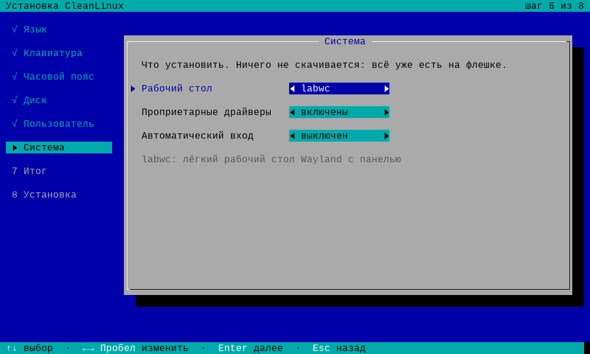
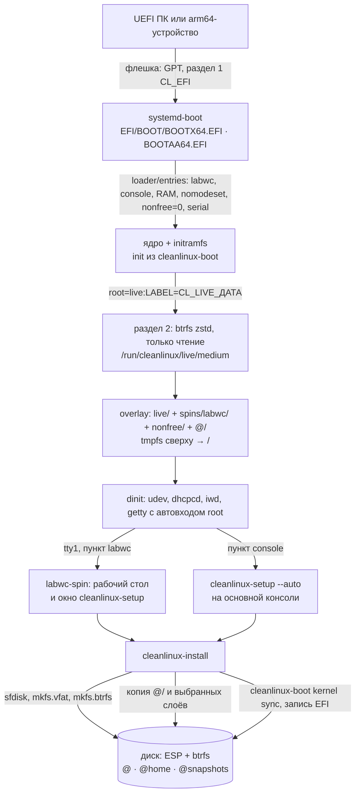

# Установка CleanLinux с флешки

Живой образ CleanLinux — один файл `cleanlinux-<arch>-<профиль>[-labwc]-ДАТА.img`: сырой образ диска (GPT,
раздел EFI и раздел btrfs). Его записывают на флешку или SD-карту **целиком, как есть**, загружают с неё
компьютер — и открывается рабочий стол labwc с окном установщика `cleanlinux-setup` (у консольного образа —
сам установщик на экране): язык, раскладка, часовой пояс, диск, пользователь, система — и через несколько
минут CleanLinux стоит на диске. Сеть для установки не нужна: установщик копирует систему прямо с флешки.

*English summary [below](#english).*

## Содержание

- [Какой образ взять](#какой-образ-взять)
- [Что нужно](#что-нужно)
- [1. Скачать и проверить образ](#1-скачать-и-проверить-образ)
- [2. Записать на флешку](#2-записать-на-флешку)
- [3. Загрузиться с флешки](#3-загрузиться-с-флешки)
- [4. Живая система](#4-живая-система)
- [5. Установщик](#5-установщик)
- [6. Первый запуск](#6-первый-запуск)
- [Установка из командной строки](#установка-из-командной-строки)
- [Если что-то пошло не так](#если-что-то-пошло-не-так)
- [Как устроен образ](#как-устроен-образ)
- [Размер](#размер)
- [Собрать образ самому](#собрать-образ-самому)
- [English](#english)

## Какой образ взять

Образы лежат в [релизе live-2026.11.6](https://github.com/vovawees/CleanLinux/releases/tag/live-2026.11.6) (у каждого —
файл `.sha256`):

| Файл | Для чего | Размер |
|---|---|---|
| `cleanlinux-x86_64-generic-x86_64-labwc-20261106.img` | ПК и ноутбуки x86_64: рабочий стол labwc и консоль | 1060 МиБ |
| `cleanlinux-aarch64-generic-aarch64-labwc-20261105.img` | устройства arm64 с UEFI: рабочий стол labwc и консоль | 668 МиБ |
| `cleanlinux-aarch64-generic-aarch64-20261105.img` | arm64 без рабочего стола: только консоль | 604 МиБ |

Образ с labwc ставит систему и с рабочим столом, и без него: это выбор на экране «Система». Рабочий стол —
[сборка labwc](https://github.com/vovawees/cleanlinux-spin-labwc), а не часть базы: на установленной системе
её можно убрать (`burn spin remove labwc`) или поставить вместо неё другую.

## Что нужно

| | |
|---|---|
| **Компьютер x86_64** | ПК или ноутбук с **UEFI** (почти все с 2012 года); процессор x86-64-v2 — Intel Core i3/i5/i7 и новее, AMD FX, Ryzen и APU с 2011 года |
| **Компьютер arm64** | устройство, прошивка которого загружает EFI-программы с флешки или SD-карты (EDK2, U-Boot с EFI); проверено пока только в QEMU (`virt`). Консолям на Snapdragon (ABL) и Raspberry Pi нужен образ под их профиль — [Собрать образ самому](#собрать-образ-самому) |
| **Secure Boot** | **выключен** в настройках UEFI: загрузчик и ядро не подписаны |
| **Память** | от 2 ГБ: живая система пишет всё в память; для пункта «copy to RAM» — ещё размер раздела системы |
| **Диск** | от 8 ГБ (меньше 3,5 ГиБ установщик не возьмёт); **диск стирается целиком** |
| **Флешка** | не меньше образа: от 2 ГБ, для arm64 хватит и 1 ГБ; всё на ней будет стёрто |

Старые ПК без UEFI (только BIOS/Legacy/CSM) не поддерживаются: и образ, и установленная система — это GPT,
раздел EFI и systemd-boot.

## 1. Скачать и проверить образ

| Система | Проверка |
|---|---|
| Linux, macOS | `sha256sum -c cleanlinux-…img.sha256` (macOS: `shasum -a 256 -c …`) |
| Windows (PowerShell) | `Get-FileHash .\cleanlinux-…img -Algorithm SHA256` — сравнить с числом из `.sha256` |

## 2. Записать на флешку

Образ пишется на флешку **целиком, побайтно** — не копированием файлов: тогда на ней получаются и раздел EFI с
загрузчиком, и раздел системы с меткой `CL_LIVE_ДАТА`, который ищет initramfs. Так же — на SD-карту.

| Где | Чем | Как |
|---|---|---|
| Linux | `dd` | `lsblk` — найти флешку (например, `/dev/sdb`, **не раздел** `sdb1`), затем `sudo dd if=cleanlinux-…img of=/dev/sdb bs=4M conv=fsync oflag=direct status=progress` |
| Linux | GNOME Disks, KDE ISO Image Writer | «Восстановить образ диска» / выбрать образ и флешку |
| Windows | [Rufus](https://rufus.ie) | выбрать флешку и файл `.img` → «Старт» (образ диска Rufus пишет как есть) |
| Windows, macOS, Linux | [balenaEtcher](https://etcher.balena.io) | Flash from file → флешка → Flash |
| macOS | `dd` | `diskutil list` → `diskutil unmountDisk /dev/diskN` → `sudo dd if=cleanlinux-…img of=/dev/rdiskN bs=4m` |
| Виртуальная машина | — | подключить `.img` как диск (USB, SATA или virtio) и включить EFI: virt-manager — «Импорт образа диска», VirtualBox — `VBoxManage convertfromraw cleanlinux-…img cleanlinux.vdi` |

Ventoy и копирование файлов на флешку не подойдут: initramfs ищет раздел с меткой образа. Записанный образ
занимает на флешке столько, сколько весит; остальное место остаётся неразмеченным.

## 3. Загрузиться с флешки

1. Вставьте флешку и включите компьютер, сразу нажимая клавишу меню загрузки:

   | Производитель | Меню загрузки | Настройки UEFI (Secure Boot) |
   |---|---|---|
   | ASUS | F8 или Esc | F2 или Del |
   | Acer | F12 | F2 |
   | Dell | F12 | F2 |
   | HP | F9 (или Esc → F9) | F10 |
   | Lenovo | F12 (или кнопка Novo) | F1 или F2 |
   | MSI | F11 | Del |
   | Gigabyte | F12 | Del |
   | ASRock | F11 | F2 или Del |
   | Samsung, Toshiba | F12 / Esc | F2 |
   | Steam Deck | громкость − и кнопка питания → Boot Manager | громкость + и питание |

2. Выберите флешку с пометкой **UEFI** (например, «UEFI: SanDisk»). Если компьютер пишет о Secure Boot —
   выключите его в настройках UEFI (раздел Security или Boot → Secure Boot → Disabled).
3. Появится меню загрузчика (systemd-boot); через 5 секунд загрузится первый пункт:

   | Пункт | Когда выбирать |
   |---|---|
   | **CleanLinux live (labwc)** | обычно: рабочий стол и установщик в окне (только в образе с labwc) |
   | CleanLinux live (console) | без рабочего стола: установщик сразу на экране (в консольном образе — просто «CleanLinux live») |
   | CleanLinux live (copy to RAM) | раздел системы копируется в память (с процентами на экране), если занимает не больше 70% свободной; потом флешку можно вынуть |
   | CleanLinux live (safe graphics) | чёрный экран или мусор после загрузки: без драйверов видеокарты (`nomodeset`) |
   | CleanLinux live (no proprietary drivers) | без слоя проприетарных драйверов (x86_64: NVIDIA, DSP Steam Deck OLED) |
   | CleanLinux live (serial console) | установка по последовательному порту (`console=ttyS0,115200`, на arm64 — `ttyAMA0`) |

   Клавиша `e` в меню правит параметры ядра выбранного пункта. На arm64 пункты для экрана начинаются с
   `console=tty0`: иначе прошивка (таблица SPCR, `stdout-path` дерева устройств) делает главной консолью свой
   последовательный порт, и установщик с рабочим столом уходят туда, а не на экран.

   

## 4. Живая система

Через несколько секунд после меню root входит сам. С пунктом **labwc** открывается рабочий стол: панель
внизу и развёрнутое на весь экран окно **Install CleanLinux** с установщиком (его можно свернуть или
уменьшить, как любое окно).



| Что | Как |
|---|---|
| Установщик | окно «Install CleanLinux»; закрыли — меню приложений → «Install CleanLinux» |
| Меню | кнопка слева на панели или клавиша Super; правый щелчок по рабочему столу |
| Терминал | Super+Enter (foot) |
| Экранная клавиатура | кнопка на панели или Super+K; на сенсорном экране появляется сама |
| Wi-Fi | в терминале: `iwctl station wlan0 scan`, `iwctl station wlan0 connect "Моя сеть"` — сеть перейдёт и в установленную систему |
| Скриншот | Print — экран, Shift+Print — область (файл в `~/Pictures`) |
| Выйти из рабочего стола | меню → Log out: останется консоль живой системы (установщик там — `cleanlinux-setup`) |

Раскладка рабочего стола — та, что выбрана в установщике или на консоли (`/etc/vconsole.conf`); для русской —
`us,ru` с переключением Alt+Shift. Если для видеокарты нет драйвера Mesa (в этих образах — Intel на x86_64 и
Mali/Panfrost на arm64: их драйверам нужен LLVM), рабочий стол рисует программный рендерер (pixman) — он работает, но
медленнее.

С пунктом **console** (и в консольном образе) установщик открывается прямо на экране. На других консолях
(Alt+F2…F4) тоже вошёл root — там обычная командная строка с подсказками (`/etc/motd`). Всё, что меняется в
живой системе, хранится в памяти и пропадает после перезагрузки; флешка не меняется.

## 5. Установщик

Управление: стрелки и **Enter** — дальше, **Esc** — назад, **Tab** — следующее поле, ←→ или Пробел меняют
значение на экране «Система», буквы — поиск в списках, **Ctrl+C** — выйти (до подтверждения на дисках ничего
не меняется). Слева — список шагов, внизу — подсказки по клавишам.

| Шаг | Экран | Что там |
|---|---|---|
| 1 | Язык · Language | English или русский — на нём будут все экраны; шрифт консоли с кириллицей включается сразу |
| 2 | Раскладка клавиатуры | раскладка консоли и рабочего стола (включается сразу); для русской — переключение Alt+Shift |
| 3 | Часовой пояс | часть света → город или UTC; можно печатать: `eur`, затем `mosc` — и по-русски, и латиницей |
| 4 | Диск | модель, размер, шина и что на диске сейчас; флешку установки, занятые диски и диски меньше 3,5 ГиБ выбрать нельзя |
| 5 | Компьютер и пользователь | имя компьютера, имя пользователя (группа `wheel`), пароль дважды; root получает тот же пароль |
| 6 | Система | **рабочий стол** — сборки с флешки (`labwc`) или «нет (консоль)»; **проприетарные драйверы** — включены по умолчанию; **профиль** — если `burn profile detect` узнал устройство (Steam Deck, ROG Ally…); **автоматический вход** — пользователь входит сам и рабочий стол открывается сразу (по умолчанию — у портативных консолей) |
| 7 | Всё готово к установке | сводка; «Установить» → «Стереть диск?» (по умолчанию — «Назад») |
| 8 | Установка | шаги, «Копирование системы: 50% · 614 MiB of 1.2 GiB», полоса и хвост журнала `/tmp/cleanlinux-install.log` |
| — | CleanLinux установлен | «Перезагрузить», «Выключить» или «Выйти в консоль» |

<table>
<tr>
<td width="50%"><br><b>1</b> · язык</td>
<td width="50%"><br><b>2</b> · раскладка</td>
</tr>
<tr>
<td><br><b>3</b> · часовой пояс</td>
<td><br><b>4</b> · диск: флешка установки недоступна</td>
</tr>
<tr>
<td><br><b>5</b> · компьютер и пользователь</td>
<td><br><b>6</b> · система</td>
</tr>
<tr>
<td><br><b>7</b> · сводка</td>
<td><br><b>8</b> · копирование системы с флешки</td>
</tr>
<tr>
<td><br>готово</td>
<td></td>
</tr>
</table>

Вынимать флешку — после выключения или когда экран погас при перезагрузке. Если установщик закрыт, снова
открыть его: `cleanlinux-setup` (на рабочем столе — меню → «Install CleanLinux»).

### Что установщик делает с диском

```
/dev/sdX (или nvme0n1, mmcblk0), GPT
├── 1  EFI System, 512 МиБ, vfat       → /boot   systemd-boot, ядро, записи загрузчика
└── 2  CleanLinux, остальное, btrfs    сжатие zstd
       ├── @            → /
       ├── @home        → /home
       └── @snapshots   → /.snapshots   снимки burn перед обновлениями
```

На диск копируется система с флешки (`@/`) и выбранные слои — проприетарные драйверы (`nonfree/`) и рабочий
стол (`spins/labwc/`); слой живой системы (`live/`) не копируется. Затем установщик пишет выбранные настройки:
`/etc/hostname`, `/etc/localtime`, `/etc/vconsole.conf`, пользователя, пароли, `fstab`, `burn.conf` (профиль,
`ALLOW_NONFREE`), запись загрузчика и запись в меню загрузки UEFI («CleanLinux» — первой). От живой системы в
новой нет ничего живого: ни автовхода root, ни установщика при входе. Шифрования диска в CleanLinux нет.

## 6. Первый запуск

После перезагрузки (флешка вынута) войдите под своим пользователем — с рабочим столом labwc он откроется сам на
первой консоли (tty1); с автоматическим входом — сразу после загрузки. root — `su -` с тем же паролем.

```sh
iwctl station wlan0 scan                 # Wi-Fi (проводная сеть настраивается сама, dhcpcd)
iwctl station wlan0 get-networks
iwctl station wlan0 connect "Моя сеть"
burn sync && burn plan                   # свежие рецепты и что обновится
burn update                              # сборка, снимок, установка
burn spin list                           # сборки системы (labwc, если выбран рабочий стол)
burn spin add https://github.com/vovawees/cleanlinux-spin-labwc   # рабочий стол на консольную систему
```

Сеть Wi-Fi, к которой вы подключились в живой системе (`iwctl`), установщик переносит в новую сам. В системе
есть редактор `nano` и всё для сборки (`base-devel`: GCC, make, perl, python, cmake, meson): burn собирает
обновления и сборки прямо на этом компьютере — в первый раз большая сборка идёт долго (часы, смотря по
процессору), дальше пересобирается только изменившееся.

## Установка из командной строки

Экраны — это обёртка над `cleanlinux-install`; в консоли или терминале живой системы им можно пользоваться
напрямую:

```sh
cleanlinux-install --help
cleanlinux-install --user anna --timezone Europe/Moscow --keymap ruwin_alt_sh-UTF-8 \
    --font cyr-sun16 /dev/nvme0n1                            # весь диск (спросит пароли)
cleanlinux-install --user anna --hostname deck --spin labwc /dev/sda     # с рабочим столом labwc
cleanlinux-install --user anna --autologin --spin labwc /dev/mmcblk0     # вход и рабочий стол сами
cleanlinux-install --no-nonfree /dev/sda                     # только свободное ПО (ALLOW_NONFREE=0)
cleanlinux-install --dry-run /dev/sda                        # показать план, ничего не меняя
cleanlinux-install --target /mnt                             # свои разделы: корень и ESP (/mnt/boot) смонтированы заранее
```

Последний вариант — для установки рядом с другой системой: разметьте диск сами (раздел EFI можно взять общий),
смонтируйте корень в `/mnt` и ESP в `/mnt/boot`. Все ключи — в
[README cleanlinux-install](https://github.com/vovawees/cleanlinux-install#установка-одной-командой-cleanlinux-install).

## Если что-то пошло не так

| Признак | Что делать |
|---|---|
| компьютер не видит флешку в меню загрузки | записать заново (dd, Rufus, Etcher); проверить, что в настройках включена загрузка с USB, а режим — UEFI |
| «Secure Boot violation», «Verification failed» | выключить Secure Boot |
| `the live medium LABEL=CL_LIVE_… did not appear` | образ скопирован файлами, а не записан целиком, или флешка не успела появиться — записать заново, попробовать другой порт USB; медленным флешкам — `rootdelay=60` (клавиша `e` в меню) |
| чёрный экран после меню | пункт **safe graphics** |
| рабочий стол не открылся, видна консоль | пункт **console** — установщик откроется на экране; журнал labwc — `~/.cache/labwc.log` |
| нет Wi-Fi | в образе прошивки самых частых чипов (Intel, Realtek, MediaTek, Qualcomm Atheros, Broadcom, Marvell); подключите кабель, а после установки закомментируйте строку `FIRMWARE=` в `/etc/burn/burn.conf` (или допишите в неё нужный префикс) и выполните `burn --rebuild install linux-firmware` — соберутся все (или нужные) прошивки |
| установка не удалась | экран показывает хвост журнала; весь журнал — `/tmp/cleanlinux-install.log` (терминал или Alt+F2; его можно скопировать на другую флешку) |
| после установки грузится не CleanLinux | выбрать «CleanLinux» в меню загрузки UEFI или поставить его первым в настройках |

## Как устроен образ



| Где | Что |
|---|---|
| раздел 1, `CL_EFI` (vfat) | `EFI/BOOT/BOOTX64.EFI` или `BOOTAA64.EFI` (systemd-boot), ядро и `initramfs.img`, `loader/` — меню из пунктов выше, `timeout 5` |
| раздел 2, `CL_LIVE_ДАТА` (btrfs, zstd:15) | обычные деревья файлов, без squashfs и ISO 9660 — см. ниже; `README.txt` |
| `@/` | система, которую ставит установщик: `base` и `base-devel` (GCC, make, perl, python, cmake, meson…), ядро, systemd-boot, установщик, iwd, nano, прошивки, `wireless-regdb`; кеша пакетов нет |
| `nonfree/` | проприетарные драйверы (x86_64: `nvidia`, `steamdeck-dsp`) — разница с `@/`; подключается по умолчанию |
| `spins/labwc/` | что добавляет сборка labwc: композитор, панель, Mesa, PipeWire, шрифты… — тоже разница с `@/` |
| `live/` | только для живой сессии: автовход root, установщик при входе, hostname `cleanlinux-live`, `/etc/motd`, Wi-Fi через iwd |
| `/etc/burn/burn.conf` | `FIRMWARE="…"` — какие прошивки собраны; новая система его сохраняет (с профилем устройства — список профиля) |

## Размер

Замеры этого релиза (раздел на флешке — btrfs zstd:15, установленная система — btrfs zstd:1):

| Образ | Файл `.img` | Раздел системы (занято) | Пакетов | Установленная система |
|---|---|---|---|---|
| x86_64 + labwc | 1060 МиБ | 1037 МиБ (999) | 165: база 79, labwc 76, драйверы ещё 10 | 1,8 ГиБ файлов → 1,3 ГиБ на `/`, 13 МиБ на `/boot` |
| arm64 + labwc | 668 МиБ | 645 МиБ (617) | 156: база 79 и labwc 77 | 1,2 ГиБ файлов → 837 МиБ на `/` |
| arm64, консоль | 604 МиБ | 581 МиБ (550) | 79 | 1,0 ГиБ файлов → 730 МиБ на `/`, 14 МиБ на `/boot` |

Больше всего места (без сжатия) занимают:

- **x86_64**: драйвер `nvidia` — 599 МиБ (весь слой `nonfree/` с Mesa и библиотеками X11, которые ему нужны, —
  710 МиБ), прошивки `linux-firmware` — 362 МиБ (только список `LIVE_FIRMWARE`, файлы уже сжаты zstd), `gcc` —
  235, `perl` — 68, `cmake` — 55, `mesa` — 47, `python` — 38, `glibc` — 36, ядро `linux` — 33 МиБ (405 модулей
  `.ko.zst`);
- **arm64**: `linux-firmware` — 225 МиБ, `gcc` — 219, ядро `linux` — 203 МиБ (1726 модулей `.ko.zst` — 22 МиБ,
  `Image` для U-Boot — 43 МиБ, деревья устройств `dtbs` — 119 МиБ: на btrfs они сжимаются в разы), `perl` — 70,
  `mesa` — 47, `cmake` — 46, `glibc` — 45, `python` — 40 МиБ.

Что сделано для размера:

- **кеша пакетов нет**: установщик копирует систему с флешки, ничего не скачивая и не собирая;
- **сжатие**: модули ядра — `.ko.zst`, прошивки — файлы `.zst`, раздел флешки — btrfs zstd:15;
- **без пустых блоков данных**: btrfs-progs 7.3-3 — `mkfs.btrfs --rootdir --shrink` больше не оставляет ~30%
  раздела под запас распределителя; образы стали примерно на четверть меньше (arm64 без рабочего стола был
  820 МиБ);
- **`base-devel` остаётся** (GCC, make, perl, python, cmake, meson) — намеренно: burn собирает пакеты на самом
  устройстве.

Что можно убрать дальше: сборочные зависимости (python-*, glslang, gperf, wayland-protocols), которые сейчас
остаются в слоях `nonfree/` и `spins/labwc/`, и общие пакеты этих двух слоёв (Mesa, libglvnd, Wayland), которые
лежат в образе дважды.

## Собрать образ самому

```sh
bootstrap/bootstrap.sh --arch x86_64 toolchain base live        # с нуля: ~4–5 часов на 2 ядрах
bootstrap/bootstrap.sh --arch x86_64 \
    --spin https://github.com/vovawees/cleanlinux-spin-labwc live  # с рабочим столом labwc
bootstrap/bootstrap.sh --arch aarch64 toolchain base live       # arm64 (на хосте arm64 или с qemu-user)
tests/live.py build/x86_64/cleanlinux-x86_64-generic-x86_64-*.img   # установка через экраны в QEMU
tools/screenshots.py IMG OUTDIR [--desktop] [--entry 1]          # снимки экранов для документации
```

Хосту для образа нужны `mtools`, `dosfstools`, `sfdisk`, python3 (`bootstrap/layer.py` делает слои) и то же,
что для `disk` (модули python3 jinja2 и pyelftools для systemd-boot); `mkfs.btrfs` с `--rootdir --compress
--shrink` (btrfs-progs 6.13+) bootstrap берёт из собранного rootfs, если на хосте его нет. root не нужен, но
стадии `native` нужны непривилегированные user namespaces (`unshare -r`) и та же архитектура, что у образа (или
qemu-user). Переменные:

| Переменная | По умолчанию | Что |
|---|---|---|
| `LIVE_FIRMWARE` | GPU, Wi-Fi, Bluetooth, Ethernet, усилители звука — для ПК (x86_64) или плат и консолей (arm64) | префиксы `/usr/lib/firmware` для `linux-firmware`; `all` — все прошивки (+2 ГБ); у профиля устройства — его `FIRMWARE` |
| `LIVE_NONFREE` | x86_64: `nvidia steamdeck-dsp`; arm64: — | пакеты слоя `nonfree/`; пусто — без слоя |
| `LIVE_PACKAGES` | `linux-firmware wireless-regdb` | пакеты поверх `DISK_PACKAGES` (ядро, systemd-boot, установщик, iwd, nano) |
| `LIVE_BASE_DEVEL` | `1` | `base-devel` в образе: установленная система сама собирает обновления и сборки (стадия `native` выполнится первой, если `base-devel` ещё не собран); `0` — в образе то, что есть в rootfs |
| `LIVE_FS` | `btrfs` | `ext4` — без сжатия (больше образ, но подойдёт прошивкам и ядрам без btrfs) |
| `LIVE_COMPRESS` | `zstd:15` | сжатие btrfs |
| `LIVE_LABEL` | `CL_LIVE_ДАТА` | метка раздела, которую ищет initramfs (до 16 символов A–Z, 0–9, `_`) |
| `--spin URL\|DIR` | — | сборка — свой слой `spins/<имя>/` и пункт меню, первый и по умолчанию |
| `DISK_PACKAGE_FEATURES` | — | строки `/etc/burn/package.features` образа: `mesa -video_cards_intel` — Mesa без драйверов, которым нужен LLVM |

## English

The CleanLinux live image is a raw disk image (GPT: an EFI system partition and a btrfs partition labelled
`CL_LIVE_<date>`) written to a USB stick or an SD card **as a whole** (dd, Rufus, balenaEtcher, GNOME Disks) that boots
on UEFI machines with Secure Boot off: x86_64 PCs, and arm64 devices whose firmware boots EFI programs (verified in
QEMU so far). The default entry opens the labwc desktop with the installer (`cleanlinux-setup`, English or Russian) in
a window; the *console* entry opens the installer on the screen. Other entries: *copy to RAM*, *safe graphics*
(`nomodeset`), *no proprietary drivers*, *serial console*. The partition holds plain trees, no squashfs: `@/` (the
system), `nonfree/` (proprietary drivers), `spins/labwc/` (the desktop) and `live/` (root's automatic login, the
installer); the init of the initramfs mounts them as an overlay with a tmpfs on top. The installer erases the chosen
disk (GPT, a 512 MiB ESP with systemd-boot, btrfs with `@`, `@home`, `@snapshots`, zstd; no encryption) and copies
`@/` and the chosen layers onto it, so no network is needed. If the live medium is not found, the image was copied as
files: write it again in raw mode. Build it with `bootstrap/bootstrap.sh --arch x86_64 toolchain base live` (add
`--spin https://github.com/vovawees/cleanlinux-spin-labwc` for the desktop); `tests/live.py` installs from it through
the screens in QEMU and boots the result.
